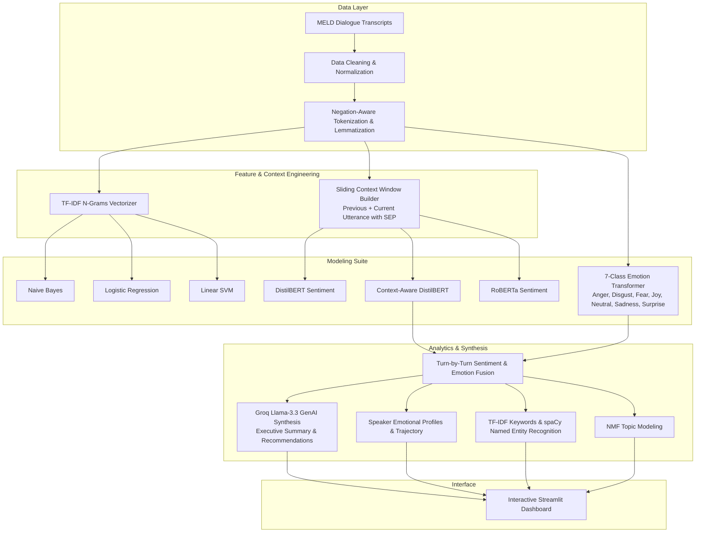

# Conversational Sentiment & Emotion Analysis

An end-to-end Natural Language Processing system for multi-turn dialogue sentiment classification, 7-class emotion recognition, conversational context modeling, and Generative AI conversational intelligence, benchmarked on the **MELD (Multimodal EmotionLines Dataset)**.

---

## 📌 Project Overview

Traditional sentiment analysis evaluates sentences in isolation. However, in human conversation:
- Meaning is heavily dependent on **conversational context** and **speaker history**.
- Sarcasm, reassurance, and emotional inflection points cannot be detected without analyzing preceding turns.
- Ambiguous responses like *"Yeah, right"* or *"I'm fine"* depend on what the previous speaker said.

This project addresses these challenges by developing a **Context-Aware Transformer pipeline** using a sliding window with `[SEP]` alignment, comparing classical machine learning baselines with state-of-the-art pretrained transformer architectures (DistilBERT and RoBERTa), and providing a live interactive dashboard with Generative AI synthesis.

---

## 🏛️ System Architecture



---

## 📊 Benchmark Results (MELD Test Set)

Evaluated across **2,610 test utterances** from the MELD benchmark:

| Model Architecture | Model Category | Accuracy (%) | Macro F1 (%) | Weighted F1 (%) | Context Window |
|---|---|---|---|---|---|
| **Naive Bayes** | Classical TF-IDF | 51.13% | 41.00% | 45.00% | 0 (Isolated turn) |
| **Logistic Regression** | Classical TF-IDF | 51.22% | 49.24% | 51.00% | 0 (Isolated turn) |
| **Linear SVM** | Classical TF-IDF | 48.69% | 46.00% | 48.00% | 0 (Isolated turn) |
| **DistilBERT** | Pretrained Transformer | 67.99% | 65.45% | 67.55% | 0 (Isolated turn) |
| **Context-Aware DistilBERT** | Context Transformer | **68.71%** | **66.94%** | **68.32%** | **2 Preceding Turns** |
| **RoBERTa** | Pretrained Transformer | **68.89%** | **66.91%** | **68.70%** | 0 (Isolated turn) |

### 🎭 7-Class Emotion Recognition Performance (`distilbert_meld_emotion`)
- **Overall Accuracy:** 63.95% | **Weighted F1:** 62.04% | **Macro F1:** 39.25%
- **Majority vs Minority Class Dynamics:** Neutral achieved 79.2% F1 and Joy reached 57.1% F1. Fear and Disgust suffered from severe MELD class imbalance (<2.5% support), illustrating class collapse under standard empirical risk minimization.

---

## 🗂️ Project Repository Structure

```text
Conversation_Sentiment_Analysis/
├── app/
│   ├── app.py                     # Streamlit web application & demo dashboard
│   └── dashboard.py               # Application entrypoint
├── data/
│   ├── raw/                       # Original MELD dialogue CSVs (train, dev, test)
│   ├── processed/                 # Cleaned datasets with tokenization & context
│   └── sample_conversations/      # Curated demo dialogues (.txt, .json, .csv)
├── models/
│   ├── classical/                 # Saved TF-IDF vectorizer + NB, LR, SVM bundle
│   ├── distilbert_meld_sentiment/ # Fine-tuned DistilBERT checkpoint
│   ├── distilbert_meld_context/   # Fine-tuned Context-Aware DistilBERT
│   ├── distilbert_meld_emotion/   # Fine-tuned 7-Class Emotion classifier
│   └── roberta_meld_sentiment/    # Fine-tuned RoBERTa checkpoint
├── notebooks/
│   ├── 01_data_exploration.ipynb  # Dataset inspection & dialogue analysis
│   ├── 02_preprocessing.ipynb     # Text cleaning & lemmatization experiments
│   ├── 03_model_training.ipynb    # Classical ML model training & tuning
│   ├── 04_model_evaluation.ipynb  # Comparative benchmark evaluation
│   ├── 05_topic_modeling.ipynb    # NMF topic clustering experiments
│   ├── 06_transformer_training.ipynb # DistilBERT, RoBERTa & Context fine-tuning
│   └── 07_emotion_training.ipynb  # 7-Class emotion classifier training
├── results/
│   ├── metrics/                   # Exported benchmark CSV metrics
│   ├── plots/                     # Comparison charts & F1 visualizations
│   └── reports/                   # Technical evaluation reports
├── src/
│   ├── cloud_nlp.py               # Cloud API interface & benchmark simulator
│   ├── context_analysis.py        # Sliding context builder & trajectory tracking
│   ├── data_loader.py             # MELD dataset download & ingestion
│   ├── feature_extraction.py      # TF-IDF keyword extraction & spaCy NER
│   ├── genai_analysis.py          # LLM prompt orchestration & payload compiler
│   ├── llm_service.py             # Groq LLM API with graceful offline fallback
│   ├── multilingual.py            # Language detection & normalization
│   ├── preprocessing.py           # Tokenization, cleaning & lemmatization
│   ├── sentiment_models.py        # Classical & Transformer inference engines
│   └── topic_modeling.py          # NMF & LDA topic extraction
├── requirements.txt               # Complete project dependencies
└── README.md                      # Project documentation
```

---

## 🚀 Quickstart & Demonstration Guide

### 1. Installation
Ensure Python 3.12 is used:
```bash
pip install -r requirements.txt
python -m spacy download en_core_web_sm
```

### 2. Launch the Demonstration Dashboard
```bash
cd Conversation_Sentiment_Analysis
streamlit run app/app.py
```

### 3. Recommended Viva / Demo Flow (10 Minutes)
1. **Choose a Preset:** Select `Preset 2: Project Deadline Escalation (Conflict Resolution)` from the dropdown.
2. **Click "Analyze Conversation":** Show turn-by-turn sentiment and emotion predictions alongside real-time inference latency (ms).
3. **Show Speaker Profiles & Trajectory:** Highlight how Alex and Jordan's sentiment scores transition from negative (conflict) to positive (resolution).
4. **Inspect the NLP Pipeline (Sidebar):** Walk through Turn 1 in the sidebar expander: Raw Utterance $\to$ Cleaned Text $\to$ Tokenization $\to$ Stopwords $\to$ Lemmatization $\to$ Transformer Context String.
5. **Demonstrate Context-Aware DistilBERT:** Switch model to `Context-Aware DistilBERT` to show how preceding turns resolve ambiguous phrases.
6. **Trigger GenAI Synthesis:** Click *"Generate Summary"* and *"Explain Dynamics"* to show executive-level insights.
